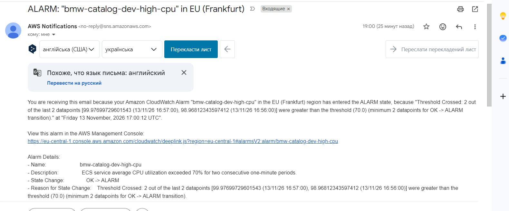
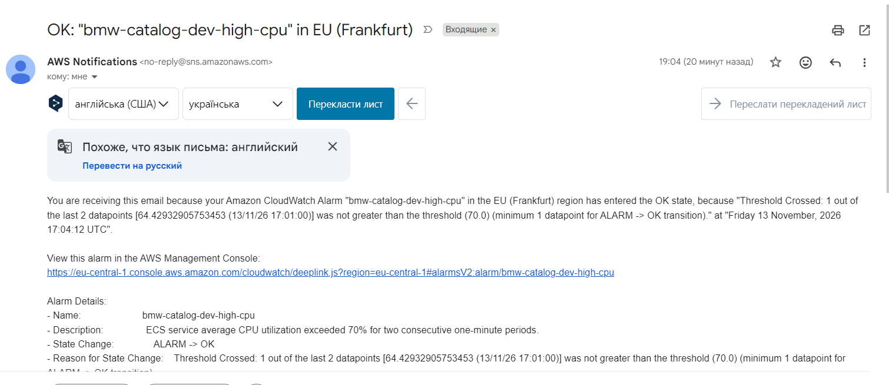

# Сповіщення (Alerts)

## Умова сповіщення
**Правило:** Завантаження процесора (CPUUtilization) > 70% протягом 2 хвилин поспіль (2 datapoints по 60 секунд).
**Канал доставки:** Електронна пошта через AWS SNS.

**Обґрунтування:**
70% — це оптимальний тригер для попередження про небезпеку. Навантаження вже високе, але сервер ще не «впав», що дає команді час на реакцію. Вимога «протягом 2 хвилин» захищає від хибних спрацьовувань (flapping) на короткочасних спайках CPU (наприклад, під час ініціалізації).

## Листи сповіщень

### 1. Тривожне сповіщення (ALARM)

* **Тема листа:** `ALARM: "bmw-catalog-dev-high-cpu" in EU-Central-1`
* **Основний зміст:** Сповіщення надійшло через перевищення заданого порогу 70% завантаження процесора протягом двох послідовних періодів по 60 секунд. У тілі листа вказано поточне значення метрики та час переходу в стан ALARM.

### 2. Відновлення норми (OK)

* **Тема листа:** `OK: "bmw-catalog-dev-high-cpu" in EU-Central-1`
* **Основний зміст:** Сповіщення про повернення системи в норму. Надійшло після закінчення навантажувального тесту та спаду завантаження CPU нижче порогового значення.

## Оцінка часу реакції
Від початку сталого навантаження до отримання першого листа пройшло приблизно 3-4 хвилини. 
Цей час формується з:
1. Агрегації першої метрики CloudWatch (1 хв).
2. Очікування другого періоду для підтвердження тривоги (ще 1 хв).
3. Доставка листа через SNS (кілька секунд).

**Оцінка:** Для звичайного REST-сервісу інтернет-магазину такий час реакції є прийнятним. Для критичних систем (наприклад, фінансовий трейдинг) це занадто повільно, і там варто зменшувати `period` до 10-30 секунд.