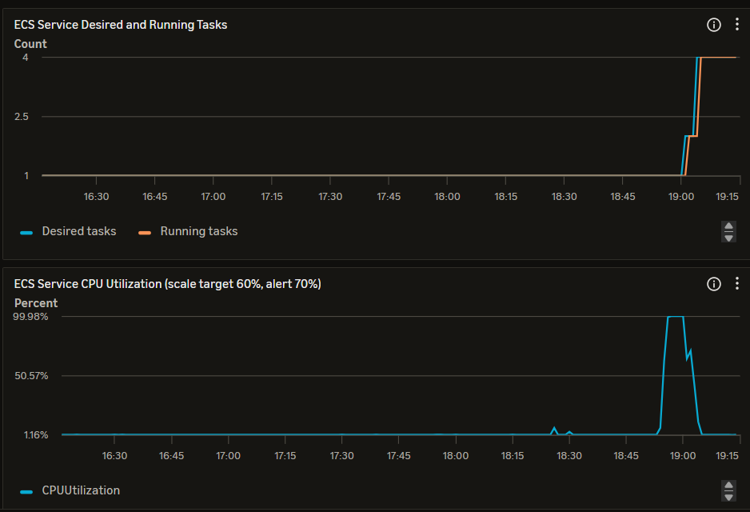

# Автоматичне масштабування (Auto Scaling)

## Параметри політики
- **Тип:** Target Tracking Scaling
- **Цільова метрика:** `ECSServiceAverageCPUUtilization` = 60%
- **Мінімум екземплярів:** 1
- **Максимум екземплярів:** 4
- **Scale out cooldown (період стабілізації при додаванні):** 60 секунд
- **Scale in cooldown (період стабілізації при вилученні):** 300 секунд

**Обґрунтування цільового значення (60% CPU):**
Поріг у 60% залишає достатній "запас міцності" (buffer) для обробки запитів, поки новий контейнер запускається. Якби ми поставили 90%, система почала б відхиляти запити до того, як новий екземпляр встигне піднятися.

**Що таке період стабілізації (cooldown) і навіщо він потрібен:**
Це час, протягом якого система ігнорує нові тригери масштабування після попередньої зміни кількості екземплярів. Якщо встановити його рівним нулю, виникне ефект нестабільного спрацьовування (flapping): система буде безперервно створювати і видаляти контейнери на кожен мікро-стрибок навантаження, що призведе до збоїв і зайвих витрат.

## Панель моніторингу під час тесту

Графік чітко демонструє момент перетину цільового порогу CPU (60%), після чого AWS ECS автоматично збільшив Desired tasks із 1 до 4 для розподілу навантаження

**Аналіз подій на графіку:**
1. **Початок навантаження:** На графіку Request Count видно плавне зростання запитів.
2. **Перетин порогу:** CPU Utilization перевищує 60% і сягає майже 100%.
3. **Поява екземпляра:** Між перетином порогу і запуском нового екземпляра проходить близько 2-3 хвилин. Це пов'язано з тим, що CloudWatch збирає метрики хвилину, потім потрібен час на прийняття рішення політикою, і ще близько хвилини ECS витрачає на завантаження Docker-образу (pull) та запуск застосунку.
4. **Вилучення екземпляра:** Відбувається значно пізніше за падіння навантаження через встановлений `scale_in_cooldown` у 300 секунд. Це захищає систему від передчасного вимкнення контейнерів у разі короткочасного спаду трафіку.