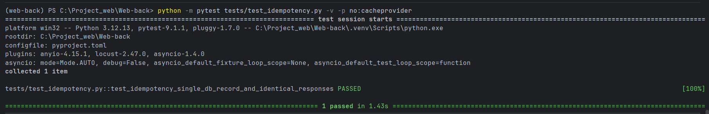
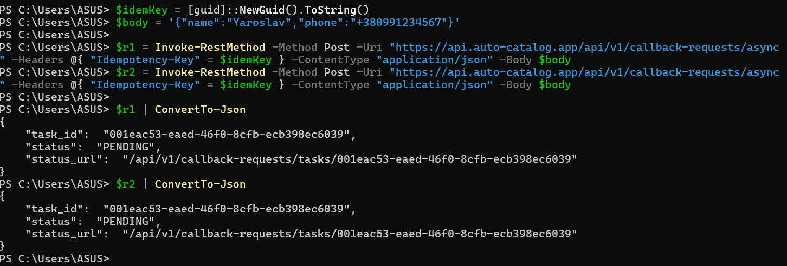

# Забезпечення ідемпотентності API-запитів (Idempotency-Key + Redis)

## Механізм роботи

Для захисту від дублювання записів у базі даних та повторної постановки задач у чергу SQS при мережевих збоях або повторних запитах клієнта (retries) реалізовано механізм ідемпотентності на базі **Redis** та заголовка `Idempotency-Key`.

### Алгоритм обробки запиту (`IdempotencyHandler`)
1. Клієнт передає унікальний ключ (UUID) у HTTP-заголовку `Idempotency-Key`.
2. Перед створенням задачі бекенд виконує атомарну операцію в Redis:
   ```text
   SET idempotency:<key> <lock_or_cached_response> NX EX <ttl>
   ```
3. **Перший запит із новим ключем:**
   - Ключ відсутній у Redis — `SET ... NX` повертає `True`.
   - Сервіс створює запис `AsyncTask` у PostgreSQL, відправляє повідомлення в AWS SQS і зберігає серіалізовану відповідь (`202 Accepted` із `task_id`) у Redis із часом життя (TTL).
4. **Повторний запит із тим самим ключем:**
   - Ключ уже існує в Redis — `SET ... NX` повертає `False`.
   - Бекенд не створює новий запис у БД і не дублює повідомлення в SQS, а повертає збережену відповідь з ідентичним `task_id`.

## Підтвердження роботи

### 1. Автоматизований інтеграційний тест (`pytest`)
Тест `tests/test_idempotency.py` відправляє два послідовні `POST`-запити з однаковим `Idempotency-Key` та перевіряє, що:
- обидва запити повертають статус `202 Accepted` та ідентичний JSON (`task_id`);
- у таблиці `async_tasks` створюється рівно **1 запис**.



### 2. Перевірка в продакшені (`api.auto-catalog.app`)
Виконання двох поспіль `POST`-запитів на `https://api.auto-catalog.app/api/v1/callback-requests/async` з одним і тим самим `Idempotency-Key` повернуло ідентичний `task_id` (`001eac53-eaed-46f0-8cfb-ecb398ec6039`):

