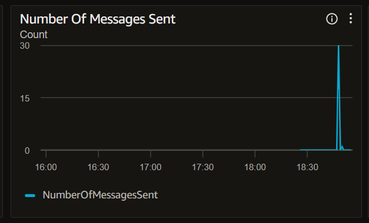
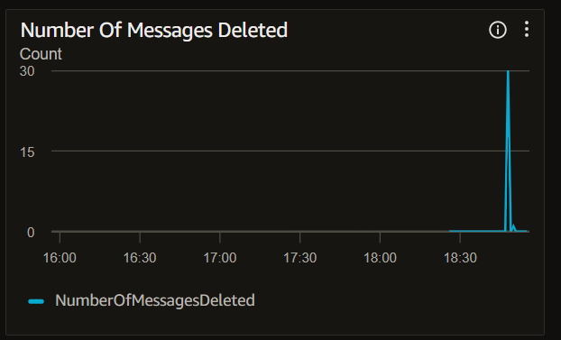
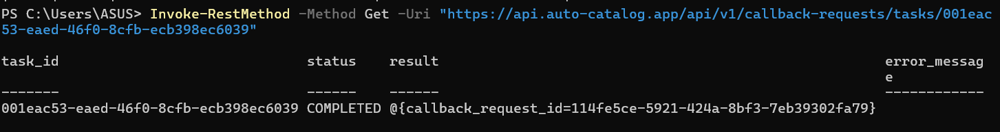

# Асинхронна обробка задач через чергу повідомлень (AWS SQS + ECS Worker)

## Архітектура рішення

Для розвантаження основного HTTP API від фонових операцій реалізовано асинхронний конвеєр обробки заявок на зворотний дзвінок на базі **AWS SQS** та окремого фонового сервісу **AWS ECS Fargate Worker**.

```text
Client
  │
  ▼  POST /api/v1/callback-requests/async (Idempotency-Key)
┌───────────────────────────┐
│   FastAPI Web Service     │
│ (bmw-catalog-dev-service) │
└───────┬───────────┬───────┘
        │           │
        │ 1. Save   │ 2. Publish message
        │ (PENDING) │
        ▼           ▼
┌──────────────┐  ┌─────────────────────────────┐
│  PostgreSQL  │  │          AWS SQS            │
│  (AWS RDS)   │  │ (bmw-catalog-dev-task-queue)│
└──────▲───────┘  └──────────────┬──────────────┘
       │                         │
       │ 4. Update               │ 3. Long polling
       │ (COMPLETED)             │
       │          ┌──────────────▼──────────────┐
       └──────────┤      ECS Fargate Worker     │
                  │  (python -m app.worker)     │
                  └─────────────────────────────┘
```

### Основні компоненти
1. **Producer (FastAPI API):**
   - Ендпоінт `POST /api/v1/callback-requests/async` валідує вхідні дані, створює запис у таблиці `async_tasks` зі статусом `PENDING`, відправляє повідомлення з `task_id` та payload у чергу SQS і миттєво повертає клієнту відповідь **`202 Accepted`**.
   - Ендпоінт `GET /api/v1/callback-requests/tasks/{task_id}` дозволяє перевірити поточний стан задачі (`PENDING`, `PROCESSING`, `COMPLETED`, `FAILED`).
2. **Черга повідомлень (AWS SQS):**
   - Черга `bmw-catalog-dev-task-queue` у регіоні `eu-central-1` буферизує вхідні задачі та гарантує їхню доставку навіть при пікових навантаженнях.
3. **Consumer (ECS Worker):**
   - Окремий ECS-сервіс `bmw-catalog-dev-worker-service` (запускає `python -m app.worker`) виконує long polling черги SQS, обробляє задачу, оновлює статус запису в PostgreSQL на `COMPLETED` та видаляє повідомлення з черги (`DeleteMessage`).
4. **Автомасштабування воркера:**
   - Налаштовано політику `TargetTrackingScaling` (`bmw-catalog-dev-worker-sqs-autoscaling`) за метрикою `ApproximateNumberOfMessagesVisible` (цільове значення — `10` повідомлень на інстанс, діапазон від `1` до `3` задач).

## Підтвердження роботи в продакшені

### Метрики черги SQS (CloudWatch)
Після відправки серії з 30 запитів на `/api/v1/callback-requests/async` черга прийняла всі повідомлення (`NumberOfMessagesSent`), а воркер успішно обробив і видалив їх (`NumberOfMessagesDeleted`):




   
### Перевірка статусу задачі через API
Запит `GET /api/v1/callback-requests/tasks/{task_id}` підтверджує перехід задачі у фінальний стан `COMPLETED`:

