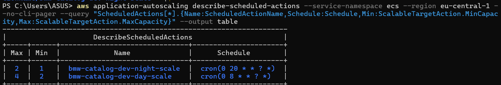

# Масштабування за розкладом (Scheduled Auto Scaling) та оптимізація витрат

## Конфігурація розкладу в AWS ECS

Для оптимізації витрат на обчислювальні ресурси **AWS Fargate** для основного вебсервісу `bmw-catalog-dev-service` налаштовано заплановане масштабування (`aws_appautoscaling_scheduled_action` у Terraform) залежно від часу доби:

| Назва правила | Розклад (UTC) | Час за Києвом (EET) | Min Capacity | Max Capacity | Призначення |
| :--- | :--- | :--- | :---: | :---: | :--- |
| `bmw-catalog-dev-day-scale` | `cron(0 8 * * ? *)` | 10:00 | **2** | **4** | Денний піковий трафік (висока доступність та запас потужності) |
| `bmw-catalog-dev-night-scale` | `cron(0 20 * * ? *)` | 22:00 | **1** | **2** | Нічний період низької активності (мінімальне споживання ресурсів) |

*(Поверх розкладу продовжує діяти політика `TargetTrackingScaling` за середнім завантаженням CPU на рівні 60%, яка дозволяє масштабуватися до `Max Capacity` у разі нетипових сплесків трафіку).*

## Розрахунок місячної економії ресурсів

Порівняння базового споживання за умовний місяць (**30 днів = 720 годин**) при постійному утриманні 2 реплік проти роботи за розкладом (12 годин вдень по 2 задачі + 12 годин вночі по 1 задачі):

1. **Без розкладу (2 задачі цілодобово 24/7):**
   $$2 \text{ tasks} \times 24 \text{ год} \times 30 \text{ днів} = 1440 \text{ task-годин/місяць}$$

2. **З розкладом (12 год × 2 задачі + 12 год × 1 задача):**
   $$(2 \text{ tasks} \times 12 \text{ год} + 1 \text{ task} \times 12 \text{ год}) \times 30 \text{ днів} = (24 + 12) \times 30 = 1080 \text{ task-годин/місяць}$$

3. **Економія обчислювальних ресурсів Fargate:**
   $$\frac{1440 - 1080}{1440} \times 100\% = \frac{360}{1440} \times 100\% = \mathbf{25\%}$$

За 30 днів розклад скорочує час роботи контейнерів на **360 task-годин** (25% витрат на vCPU та Memory основного вебсервісу) без втрати пропускної здатності у денні години.

## Підтвердження налаштувань у AWS

Вивід AWS CLI (`aws application-autoscaling describe-scheduled-actions`), що підтверджує активні правила масштабування для сервісу `bmw-catalog-dev-service`:

